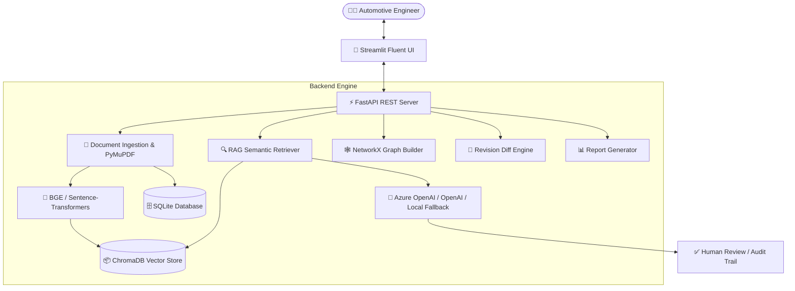

# 🚗 AutoHLD-AI: GenAI-Powered AUTOSAR HLD Document Analysis & Traceability Assistant

[](https://fastapi.tiangolo.com)
[](https://streamlit.io)
[](https://www.trychroma.com)
[](https://www.python.org/)
[](LICENSE)

**AutoHLD-AI** is an engineering intelligence platform designed for automotive system architects, safety managers, and software engineers. It automates the parsing, analysis, dependency mapping, revision comparison, and compliance auditing of **AUTOSAR Classic & Adaptive High-Level Design (HLD)** specifications.

---

## 🌟 Key Capabilities

1. **📄 Context-Aware Ingestion & Parsing**:
   - Ingests AUTOSAR HLD documents (PDF, DOCX, TXT, MD) using **PyMuPDF**, **pdfplumber**, and OCR.
   - Preserves section headings, table schemas, and component boundaries during chunking.

2. **🧩 Architecture Entity & Safety Extraction**:
   - Automatically detects Software Components (**SWCs**), provided/required ports (**P-Ports / R-Ports**), **Sender-Receiver** and **Client-Server** interfaces, and **ISO 26262 ASIL** allocations (ASIL-A/B/C/D & QM).

3. **💬 Evidence-Grounded Conversational RAG (Ask HLD)**:
   - Natural language question answering strictly grounded in retrieved HLD context with **exact page number citations** and excerpt verification.
   - Built-in confidence gauges and distinction between factual assertions and architectural inferences.

4. **🕸️ Interactive Architecture Topology Graph**:
   - **NetworkX** & **Plotly** powered directed graph visualizing component interactions, degree centrality, isolated SWCs, and potential cyclic dependencies.

5. **🔄 Revision Comparison Engine (HLD v1 vs v2)**:
   - Automated architectural diff identifying **+Added**, **-Removed**, **~Modified** components/interfaces and detecting breaking changes between releases.

6. **👨‍💻 Human-in-the-Loop (HITL) Review & Governance**:
   - AI outputs are never presented as final signoff. Engineers can **Accept**, **Reject**, or **Edit** AI-detected findings with recorded rationale and immutable audit logs.

7. **📊 Multi-Format Engineering Reports**:
   - 1-click export of structured reports in **PDF**, **Excel (.xlsx)**, **Word (.docx)**, and **JSON** formats.

---

## 🏗️ System Architecture



---

## 📁 Project Structure

```
AutoHLD-AI/
├── backend/
│   ├── main.py                  # FastAPI server entry point & CORS configuration
│   ├── api/                     # REST API routers
│   │   ├── upload.py            # Document ingestion & indexing endpoints
│   │   ├── query.py             # Grounded RAG Q&A endpoints
│   │   ├── analysis.py          # Architecture analysis & graph endpoints
│   │   ├── comparison.py        # HLD revision diff endpoints
│   │   ├── reports.py           # Report export & audit log endpoints
│   │   └── analytics.py         # AI/ML evaluation metrics & rubric endpoints
│   ├── database/                # SQLite connection & CRUD operations
│   │   ├── session.py
│   │   └── crud.py
│   ├── models/                  # Pydantic schemas & SQLAlchemy ORM models
│   │   ├── schemas.py
│   │   └── db_models.py
│   ├── rag/                     # Retrieval-Augmented Generation pipeline
│   │   ├── ingestion.py         # PDF parsing & table extraction
│   │   ├── chunking.py          # Component/section aware chunker
│   │   ├── embeddings.py        # BGE-small embeddings & local fallback
│   │   ├── vector_store.py      # ChromaDB persistent store
│   │   ├── retriever.py         # Keyword reranking & evidence filter
│   │   ├── prompts.py           # Standardized prompt templates
│   │   └── citations.py         # Citation formatting & snippet extraction
│   ├── services/                # Business logic services
│   │   ├── document_service.py
│   │   ├── llm_service.py       # Azure OpenAI / OpenAI / Local reasoning
│   │   ├── embedding_service.py
│   │   ├── rag_service.py
│   │   ├── extraction_service.py
│   │   ├── comparison_service.py
│   │   ├── report_service.py
│   │   └── ml_analytics_service.py  # 12 Evaluation metrics, EDA, & ML benchmark engine
│   └── utils/
│       ├── graph_builder.py     # NetworkX topology analysis
│       └── logger.py
├── frontend/
│   ├── app.py                   # Main Streamlit dashboard
│   ├── styles.py                # Fluent UI CSS styling
│   ├── components/
│   │   ├── ui_components.py     # Metric cards, hero banners, ASIL badges
│   │   └── graph_view.py        # Plotly interactive network graph
│   └── pages/
│       ├── 1_📄_Document_Upload.py
│       ├── 2_🔍_Architecture_Analysis.py
│       ├── 3_💬_Ask_HLD.py
│       ├── 4_🕸️_Architecture_Graph.py
│       ├── 5_🔄_Compare_Revisions.py
│       ├── 6_✅_Findings_&_Review.py
│       ├── 7_📊_Reports.py
│       └── 8_🤖_ML_Analytics.py  # 12-metric evaluation dashboard & EDA visualizations
├── data/
│   ├── documents/               # Uploaded PDF specifications
│   ├── processed/               # Chunks & intermediate representations
│   ├── chroma/                  # ChromaDB vector collection files
│   ├── reports/                 # Generated PDF/XLSX/DOCX reports
│   └── sample_hld/              # Benchmark AUTOSAR v1.0 & v2.0 PDFs
├── scripts/
│   ├── generate_sample_hld.py   # Generates sample AUTOSAR HLD PDFs
│   └── seed_sample_data.py      # Seeds database & ChromaDB with sample data
├── tests/                       # Unit & integration test suite
│   ├── test_api.py
│   └── test_extraction.py
├── Dockerfile
├── docker-compose.yml
├── requirements.txt
├── .env.example
├── .env
├── .gitignore
└── README.md
```

---

## 🚀 Quick Start Guide

### 1. Prerequisites
- Python 3.10, 3.11, or 3.12
- Git

### 2. Installation

Clone the repository and install dependencies:
```bash
git clone https://github.com/your-username/AutoHLD-AI.git
cd AutoHLD-AI

# Create virtual environment
python -m venv venv
# On Windows:
.\venv\Scripts\activate
# On Linux/macOS:
source venv/bin/activate

# Install required packages
pip install -r requirements.txt
```

### 3. Environment Setup

Copy `.env.example` to `.env`:
```bash
cp .env.example .env
```

Configure your Azure OpenAI or OpenAI credentials (Optional — if not provided, AutoHLD-AI automatically operates in deterministic local intelligence mode):
```env
AZURE_OPENAI_ENDPOINT=https://your-resource-name.openai.azure.com/
AZURE_OPENAI_API_KEY=your_api_key_here
AZURE_OPENAI_API_VERSION=2024-02-15-preview
AZURE_OPENAI_DEPLOYMENT=gpt-4o

CHROMA_PERSIST_DIR=./data/chroma
DATABASE_URL=sqlite:///./data/autohld.db
EMBEDDING_MODEL=BAAI/bge-small-en-v1.5
```

### 4. Generate & Seed Benchmark Sample Data

Run the sample generation and database seeding scripts:
```bash
python scripts/generate_sample_hld.py
python scripts/seed_sample_data.py
```

### 5. Launch the Application

Start the **FastAPI Backend**:
```bash
uvicorn backend.main:app --host 127.0.0.1 --port 8000 --reload
```

In a separate terminal, launch the **Streamlit Frontend**:
```bash
streamlit run frontend/app.py
```

- **Frontend Dashboard**: [http://localhost:8501](http://localhost:8501)
- **FastAPI Swagger Docs**: [http://localhost:8000/docs](http://localhost:8000/docs)

---

## 🐳 Docker Deployment

To launch the complete platform using Docker Compose:
```bash
docker-compose up --build
```
Access the application at [http://localhost:8501](http://localhost:8501).

---

## 📖 Walkthrough: End-to-End Demo Workflow

1. **Dashboard (`app.py`)**:
   - Inspect active HLD documents, parsed pages count, and pending AI review findings.
2. **Document Upload (`1_📄_Document_Upload.py`)**:
   - Upload your own AUTOSAR HLD or click **"Re-index Benchmark HLD"** to process the included Braking & ADAS specifications.
3. **Architecture Analysis (`2_🔍_Architecture_Analysis.py`)**:
   - Explore extracted SWCs (`BrakeController`, `VehicleController`, `SensorFusion`), port signatures, interfaces, and signals with ASIL color badges.
4. **Ask HLD (`3_💬_Ask_HLD.py`)**:
   - Click suggested queries like *"What components depend on BrakeController?"* or ask custom questions to view answers with exact page citations and confidence scores.
5. **Architecture Graph (`4_🕸️_Architecture_Graph.py`)**:
   - Visualize the directed communication graph and verify absence of cyclic coupling.
6. **Compare Revisions (`5_🔄_Compare_Revisions.py`)**:
   - Select HLD v1.0 and HLD v2.0 to inspect added components (`ADASCruiseControl`, `CameraInterface`), removed components (`CAN_Gateway`), and safety impact changes.
7. **Findings & Review (`6_✅_Findings_&_Review.py`)**:
   - Execute Human-in-the-Loop review: choose **Accept**, **Reject**, or **Edit** on detected findings with engineer notes.
8. **Reports & Audit (`7_📊_Reports.py`)**:
   - Export official PDF/Excel/Word architecture reports and inspect the immutable ISO 26262 audit log.

---

## 🧪 Running Tests

Run the test suite with `pytest`:
```bash
pytest tests/ -v
```

---

## 🛡️ Functional Safety & Compliance Statement

> **Notice**: AI-generated findings and summaries generated by AutoHLD-AI serve as assistive intelligence. In accordance with **ISO 26262** and automotive governance guidelines, all architectural approvals, safety integrity level assessments, and software release authorizations must be formally reviewed and signed off by authorized human engineering specialists.

---

## 🤝 Contributing & License
Contributions are welcome! Please submit a PR or open an issue.
Licensed under the **MIT License**.
